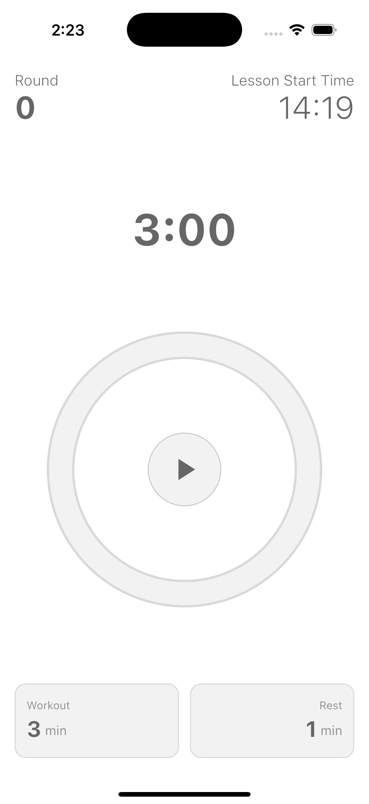
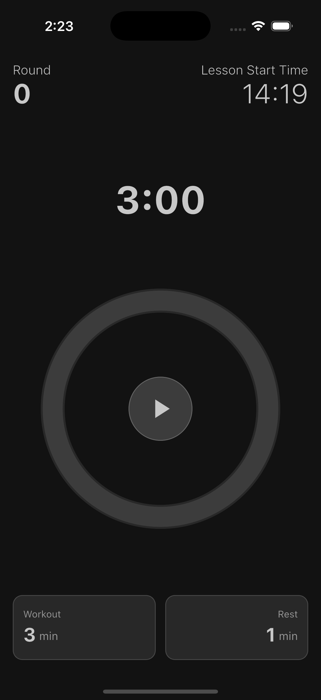

# WorkoutBell

**Train. Rest. Hear the bell.**

A glanceable interval timer for HIIT, boxing, circuits, and class rounds — big countdown, color ring, round counter, and a clear bell when the phase changes.

**[Open free web app →](https://iravan.github.io/workout_timer/)**

## Screenshots

| Light mode | Dark mode |
|:---:|:---:|
|  |  |

## Why WorkoutBell

- **Built for the gym floor** — large time, green = work / red = rest, readable from a few steps away
- **Boxing-style cue** — bell sound when a phase ends (haptic fallback if needed)
- **Rounds that matter** — automatic round count for classes and circuits
- **No friction** — no account, no ads, no subscription; preferences saved on device
- **Ready worldwide** — English, Spanish, French, Japanese, Chinese (Simplified + Traditional)

## Features

- Workout intervals: 1–30 minutes
- Rest intervals: 30 seconds–10 minutes
- Circular progress ring (clockwise)
- Start / pause / reset with confirmation when it matters
- Session start time (long-press for seconds)
- System light & dark mode
- Screen stays awake during training
- Works offline on device; free browser demo on GitHub Pages

## Perfect for

HIIT · Boxing / martial arts · Circuit training · Strength rest timers · Group classes · Personal training

## Usage

- **Play / Pause** — start or pause under the ring
- **Stop** — reset the timer (asks to confirm after you have rounds)
- **+ / −** — set workout and rest durations (locked while running)
- **?** — help with every control
- **Started** — long-press to show hours:minutes:seconds

## Platforms

Flutter app for **iOS** and **Android**, plus a **web demo**:  
https://iravan.github.io/workout_timer/

## Run locally

```bash
flutter pub get
flutter run
```

## Privacy

WorkoutBell does not collect personal data. Preferences stay on your device.  
See [Privacy Policy](PRIVACY.md).

## License

Personal / portfolio project. See repository for details.
